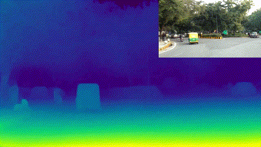

## [model_components](./model_components/)
Contains the modular PyTorch building blocks of the `Scene3DNetwork` architecture (`SceneSegNetwork` EfficientNet-B0 upstream backbone wrapped by `PreTrainedBackbone`, `DepthContext` residual attention module, `Scene3DNeck` decoder with skip connections, and `Scene3DHead` dense depth regression head).

## [inference](./inference/)
Helper classes (`Scene3DNetworkInfer` and `Scene3DONNXInfer`) for running PyTorch (`.pth` / `.pt`) and ONNX Runtime (`.onnx`) inference with trained Scene3D checkpoints.

## [visualizations](./visualizations/)
Scripts to run inference using trained models and generate single/batch image and video viridis depth-map visualizations.

## [training](./training/)
Training pipeline (`train_scene_3d.py` and `scene_3d_trainer.py`) configured for relative depth distillation with Scale Invariant robust MAE + Multi-Scale Edge Preservation loss and TensorBoard logging.

## [data_parsing](./data_parsing/)
Dataset preprocessing scripts (`Argoverse`, `DDAD`, `DrivingStereo`, `KITTI`, plus `LidarDepthFill` in `common/`) and DepthAnythingV2-Large pseudo-labeling instructions for preparing Scene3D training data.

## [data_utils](./data_utils/)
Dataset loader (`LoadDataScene3D`), sanity-check utility (`CheckData`), albumentations-based depth augmentations (`Augmentations`), and model profiling/latency benchmarking (`benchmark.py`).

## [exports](./exports/)
Utilities to convert trained PyTorch `.pth` checkpoints to FP32 `.onnx` (`convert_pytorch_to_onnx.py`) and TorchScript `.pt` (`trace_pytorch_model.py`), and to benchmark PyTorch vs. ONNX Runtime models (`benchmark_onnx_models.py`).
