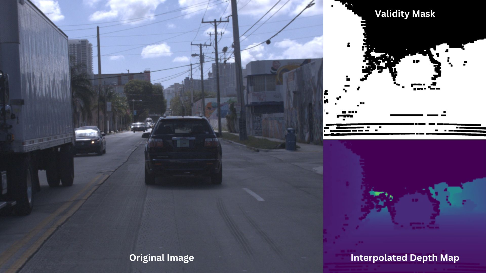

# Scene3D Relative & Metric Depth Datasets

In order to create the relative depth dataset used to train Scene3D, the DepthAnythingV2-Large model was utilized to generate pseudo-labels for a variety of street scene images capturing variations in time of day, weather conditions, camera mounting height, camera mounting angle, and camera lens type (fisheye to zoom).


## Street-level scenes
Specifically, images from the following street-scene datasets were processed to create pseudo-labels, resulting in a total dataset size of 488,535 images with associated pseudo-labels. The KITTI, DDAD, and DrivingStereo datasets were temporally downsampled to prevent model overfitting:

- [BDD100K](https://www.kaggle.com/datasets/marquis03/bdd100k)
- [Mapillary Vistas](https://www.mapillary.com/dataset/vistas)
- [ROADWork](https://www.cs.cmu.edu/~ILIM/roadwork_dataset/)
- [Comma10K](https://github.com/commaai/comma10k)
- [KITTI](https://www.cvlibs.net/datasets/kitti/raw_data.php)
- [DDAD](https://github.com/TRI-ML/DDAD#dataset-details)
- [Driving Stereo](https://drivingstereo-dataset.github.io/)
- [Indian Driving Dataset](https://idd.insaan.iiit.ac.in/)
- [Zenesact Open Dataset](https://zod.zenseact.com/frames/)
- [Mapillary Planet Scale dataset - Images only](https://www.mapillary.com/dataset/depth)

## DepthAnythingV2-Large Pseudo Labels

To create pseudo-labels, clone the [DepthAnythingV2 repository](https://github.com/DepthAnything/Depth-Anything-V2/tree/main) and download the [ViT-Large model weights](https://huggingface.co/depth-anything/Depth-Anything-V2-Large/resolve/main/depth_anything_v2_vitl.pth?download=true). Save the script below inside the DepthAnythingV2 repository folder as `create_pseudo_label.py` and run it (make sure your output directory contains `images/` and `depth/` subdirectories):

### Example Usage
```bash
python3 create_pseudo_label.py --img-path /path/to/input/image/folder --outdir /path/to/where/data/is/saved
```

### create_pseudo_label.py
```python
import argparse
import os
import pathlib

import cv2
import numpy as np
import torch

from depth_anything_v2.dpt import DepthAnythingV2


if __name__ == "__main__":
    parser = argparse.ArgumentParser(description="Depth Anything V2")
    parser.add_argument("--img-path", dest="img_path", required=True)
    parser.add_argument("--outdir", dest="save_path", required=True)
    parser.add_argument(
        "--encoder",
        type=str,
        default="vitl",
        choices=["vits", "vitb", "vitl", "vitg"],
    )
    parser.add_argument("--input-size", type=int, default=518)
    args = parser.parse_args()

    DEVICE = (
        "cuda"
        if torch.cuda.is_available()
        else "mps"
        if torch.backends.mps.is_available()
        else "cpu"
    )

    model_configs = {
        "vits": {"encoder": "vits", "features": 64, "out_channels": [48, 96, 192, 384]},
        "vitb": {"encoder": "vitb", "features": 128, "out_channels": [96, 192, 384, 768]},
        "vitl": {"encoder": "vitl", "features": 256, "out_channels": [256, 512, 1024, 1024]},
        "vitg": {"encoder": "vitg", "features": 384, "out_channels": [1536, 1536, 1536, 1536]},
    }

    depth_anything = DepthAnythingV2(**model_configs[args.encoder])
    depth_anything.load_state_dict(
        torch.load(f"checkpoints/depth_anything_v2_{args.encoder}.pth", map_location="cpu")
    )
    depth_anything = depth_anything.to(DEVICE).eval()

    image_save_filepath = os.path.join(args.save_path, "images")
    depth_filepath = os.path.join(args.save_path, "depth")
    os.makedirs(image_save_filepath, exist_ok=True)
    os.makedirs(depth_filepath, exist_ok=True)

    images = sorted([f for f in pathlib.Path(args.img_path).glob("*.jpg")])
    print(len(images), "samples found")

    for index, img_path in enumerate(images):
        print("processing image", index, "of", len(images) - 1)
        image = cv2.imread(str(img_path))
        _, width, _ = image.shape

        if 800 < width <= 1300:
            image = cv2.resize(image, (0, 0), fx=0.8, fy=0.8)
        elif 1300 < width <= 1800:
            image = cv2.resize(image, (0, 0), fx=0.5, fy=0.5)
        elif 1800 < width <= 2600:
            image = cv2.resize(image, (0, 0), fx=0.4, fy=0.4)
        elif width > 2600:
            image = cv2.resize(image, (0, 0), fx=0.25, fy=0.25)

        depth = depth_anything.infer_image(image, input_size=args.input_size)

        np.save(os.path.join(depth_filepath, f"{index}.npy"), depth)
        cv2.imwrite(os.path.join(image_save_filepath, f"{index}.jpg"), image)

    print("Processing complete")
```

## Scene3D Metric Depth Dataset
To train a metric depth network, a custom dataset was created using open-source datasets that capture scene depth through LiDAR scanners or stereo disparity. Raw depth maps were interpolated to fill holes and create a densified ground truth, alongside validity masks indicating pixels with valid depth measurements.



Supported metric dataset parsers:
- [Argoverse](./Argoverse/) (`Argoverse/process_argoverse.py`)
- [KITTI](./KITTI/) (`KITTI/process_kitti.py`)
- [DDAD](./DDAD/) (`DDAD/process_ddad.py`)
- [DrivingStereo](./DrivingStereo/) (`DrivingStereo/process_driving_stereo.py`)

## common
Contains helper class [`LidarDepthFill`](./common/lidar_depth_fill.py) to perform LiDAR depth map interpolation and densification.
