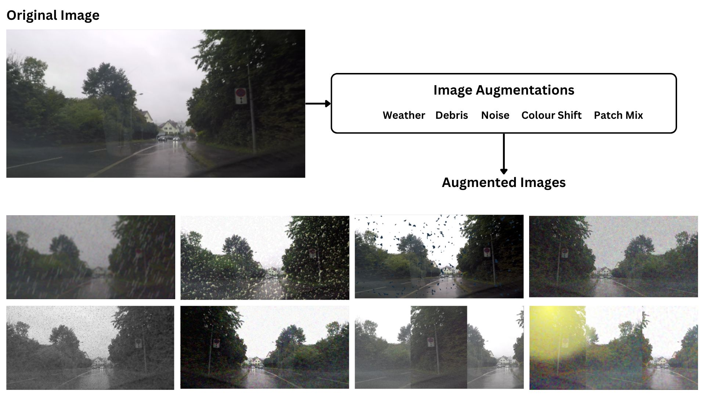

## augmentations.py
Image augmentation is an essential part of training visual neural networks. It helps harden the network to various noise effects during training and helps reduce data overfitting. The [albumentations library](https://albumentations.ai/) is used to apply resizing to `640x320`, random horizontal flipping, and noise/weather/lighting augmentations for `DEPTH`.



## check_data.py
Helper class to perform a sanity check on dataset integrity, ensuring that input images and ground-truth depth maps are non-empty and match in count.

## load_data_scene_3d.py
Helper class (`LoadDataScene3D`) for loading Scene3D training/validation pairs (`image/` and `relative-depth/` `.npy` maps), normalizing depth labels, and splitting samples into training and validation subsets (19:1 split).

## benchmark.py
Script to print model layer summary, parameter count, FLOPs, and measure PyTorch inference latency at `fp32` or `fp16` precision:

```bash
python3 Models/data_utils/benchmark.py -n Scene3D -p fp32
```
