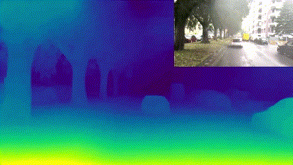

## Scene3D
Depth estimation is an essential technology for safe operation of self-driving cars, especially in challenging edge case scenarios. By sensing depth, self-driving cars are able to detect important objects in the scene irrespective of their appearance. Scene3D is able process monocular camera images to produce high resolution depth maps with sharp object boundaries, visible on the leaves of trees, thin structures such as poles, and on the edges of foreground objects - helping self-driving cars understand the dynamic driving scene in real-time. Scene3D enables important downstream perception tasks such as foreground obstacle detection, and is robust to changes in object appearance, size, shape and type, addressing 'long-tail' edge case scenarios. The current release of Scene3D estimates per-pixel relative depth, indicating which objects are nearer vs further away from the camera. Scene3D is part of the [AutoSeg Foundation Model](https://github.com/autowarefoundation/autoware.privately-owned-vehicles/tree/main/AutoSeg) which forms the core of the vision-pipeline of the [Autoware Autonomous Highway Pilot System](https://github.com/autowarefoundation/autoware.privately-owned-vehicles/tree/main)

## Watch the explainer video
Please click the video link to play - [***Video link***](https://drive.google.com/file/d/19E57_ECVF3ImMGY8TNmg7dqixH1ej8MB/view?usp=drive_link)

## Scene3D model weights
### [Link to Download Pytorch Model Weights *.pth](https://drive.google.com/file/d/1MrKhfEkR0fVJt-SdZEc0QwjwVDumPf7B/view?usp=sharing)
### [Link to Download Traced Pytorch Model *.pt](https://drive.google.com/file/d/1-LO3j2YCvwxeNLzyLrnzEwalTrYUZgK0/view?usp=drive_link)
### [Link to Download ONNX FP32 Weights *.onnx](https://drive.google.com/file/d/19gMPt_1z4eujo4jm5XKuH-8eafh-wJC6/view?usp=drive_link)

## Performance Results
Scene3D was trained on a diverse dataset comprised of multiple open-source datasets, including Mapillary BDD100K, Mapillary Vistas, ROADWork, Comma10K, KITTI, DDAD, Driving Stereo, Indian Driving Dataset, Zenesact Open Dataset and the Mapillary Planet Scale Dataset. RGB images from these datasets were processed using DepthAnythingV2 VIT-Large model to create ground truth relative depth map pseudo labels - resulting in 488,535 total samples, of which 24,426 samples were set aside for validation. In essence, we perform a model distillation from DepthAnythingV2 Large, which employs a computationally heavy transformer architecture originally trained on 62 Million images, to a lightweight, convolutional neural network architecture which is real-time capable on edge hardware.

During training, Scene3D estimates a relative depth map which is compared with the ground truth pseudo labels from DepthAnything to calculate the network loss. We utilize 2 loss functions, a Scale Invariant Loss and an Edge Preservation Loss:

### Scale Invariant Loss
Multiple scale and scale shift invariant losses were tried, however, we found that the best results were achieved by applying min-max scaling to the predicted and ground truth depth pseudo label and then calcuating a robust mean absolute error (ignoring the top 10% of erroneous pixels as they were likely caused by errors in the ground truth pseudo labels)

### Edge Preservation Loss
In order to preserve sharp edges in the depth map, an edge preservation loss was applied which applies a 3x3 derivative kernel in x and y directions to calculate the edge gradients in the prediction and ground truth depth pseudo label and calculates the mean absolute error. To ensure smoothness and for regularization, this edge preservation loss was applied at multiple image scales (full-size, 1/2 , 1/4, 1/8). The final edge preservation loss was calculated as an average between the individual edge losses at multiple scales.

### Total Loss
The total loss is set to a weighted sum of the Scale Invariant Loss and Edge Preservation Loss to ensure both losses are of similar magnitude during training.

### Training Details
The network was trained in 2 stages, during the first stage the batch size was set to 24 and the learning rate was set to 1e-4. The best network from stage 1 (as measured on validation dataset results) was finetuned in stage 2 with a batch size of 3 and a learning rate of 1.25e-5. Heavy data augmentations were used to increase the network's robustness to noise and improve generalization. Furthermore, a random horiztonal grid-flip augmentation was applied in which the image was split in half and the left and right halves of the image were swapped. This resulted in variations of depth distributions for the scene and prevented the network from over-fitting to a front facing camera perspective. During the second stage of training, color and space augmentations were removed, and only a random horizontal flip augmentation was retained.

### Validation Set Performance - Loss
| Total Loss | Scale Invariant Loss | Edge Preservation Loss |
|------------|----------------------|------------------------|
| **0.08408** | 0.07004 | 0.01404 | 

### Further Observations
Typically, DepthAnything V2 model predictions suffer from flickering artefacts when run sequentially on frame-by-frame video predictions. In order to mitigate this, the authors introduced a new version of the model which adds Temporal Attention. We find however, that altough Scene3D was trained using depth pseudo labels from DepthAnything V2 without Temporal Attention, flickering artefacs are not present in Scene3D predictions. This is likely due to the fact that Scene3D is able to learn more gernalizable features which are domain specific (on-road driving data only) and capture more detailed context related to driving scenes. Furthermore, we do not apply a shift invariant loss, so it is also likely that Scene3D has learned starting road depth visible in the bottom of the image as an anchor for the depth of the scene.

### Inference Speed
Inference speed tests were performed on a laptop equipped with an RTX3060 Mobile Gaming GPU, and an AMD Ryzen 7 5800H CPU. The SceneSeg network comprises a total of 238.41 Billion Floating Point Operations.

#### FP32 Precision
At FP32 precision, Scene3D achieved 15.1 Frames Per Second inference speed

#### FP16 Precision
At FP16 precision, Scene3D achieved 23.9 Frames Per Second inference speed

---

# Scene3DLite

Scene3DLite is a lightweight monocular **relative depth estimation** model distilled from large-scale transformer-based depth models (DepthAnythingV2 as in the original Scene3D) to a compact convolutional architecture.

It preserves:

- Edge sharpness  
- Relative depth ordering  
- Scale-consistent predictions  

while reducing computational overhead.

---

## Inference performance – Embedded Inference – Jetson Orin Nano (8GB)

**Forward pass includes:** H2D + Inference + D2H

### Scene3D vs Scene3DLite

### Scene3D vs Scene3DLite

| Model         | GOPs | Backend        | Forward [ms] | FPS  |
|--------------|------|---------------|--------------|------|
| Scene3D      | 224  | FP32 ONNX     | 168.4        | 5.9  |
| Scene3D      | 224  | FP32 TensorRT | 99.7         | 10.0 |
| Scene3DLite  | 7.78 | FP32 ONNX     | 41.0         | 24.4 |
| Scene3DLite  | 7.78 | FP32 TensorRT | 23.4         | 42.7 |
| Scene3DLite  | 7.78 | INT8 TensorRT | 10.9         | 91.4 |

---

## Scene3DLite model weights

### [Download PyTorch Weights (*.pth)](https://drive.google.com/file/d/18YFLGQp0xPmhys-9SFW4BLu91PcOVXlL/view?usp=drive_link)
### [Download ONNX FP32 (*.onnx)](https://drive.google.com/file/d/1H3EUps_v_ydTnwxATsfHy_DABGt9ztiT/view?usp=drive_link)
---
